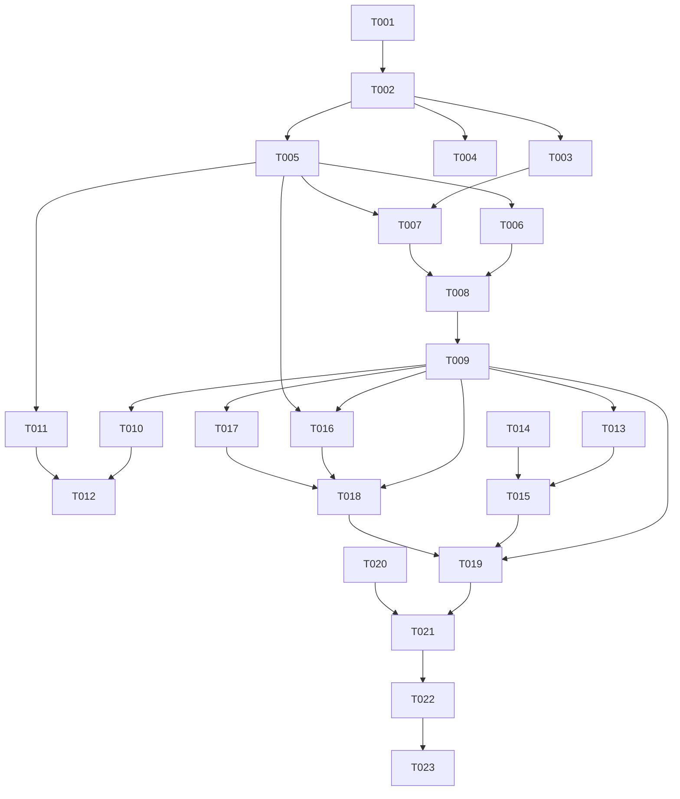

# Tasks: 个人加密笔记应用（EncryptedNote）

**Input**: Design documents from `Assignment4/spec/encrypted-note/`（spec.md + plan.md）  
**Prerequisites**: plan.md (required), spec.md (required for user stories)  
**Tests**: 未要求测试任务（实验以构建 + 人工验证步骤覆盖）  
**Organization**: 按用户故事分组，支持独立实现与验证。

**Project Root**: `D:\code\HarmonyProject\Assignment4`（由 T001 脚手架创建）  
以下 `entry/src/main/...` 路径均相对 Project Root。

## Format: `[ID] [P?] [Story] Description`

- **[P]**: 可并行（不同文件、无未完成依赖）
- **[Story]**: 所属用户故事（US1-US4，映射 spec.md）
- 每个任务描述均含精确文件路径

## Path Conventions

- 单工程结构：`entry/src/main/ets/` 为源码根（单 entry 模块，无 features/common 子模块）
- 规格文档：`Assignment4/spec/encrypted-note/`
- 构建配置：`Assignment4/build-profile.json5`（脚手架生成，不修改）
- 页面登记：`entry/src/main/resources/base/profile/main_pages.json`

## Phase 1: Setup（共享基础设施）

**Purpose**: 工程脚手架与初始化

- [X] T001 加载 deveco-cli skill，执行 `devecocli create --app-name EncryptedNote --project-path D:\code\HarmonyProject\Assignment4` 创建工程（bundle-name 用默认 com.example.encryptednote；api-level 用默认/auto 对齐当前环境 SDK；若返回 PROJECT_EXISTS 则停止并报告，不覆盖）
- [X] T002 检查脚手架产物与 SDK 配置：确认 `build-profile.json5`、`entry/src/main/module.json5`、`entry/src/main/ets/entryability/EntryAbility.ets`、`entry/src/main/resources/base/profile/main_pages.json` 存在，记录实际 compatibleSdkVersion/targetSdkVersion；随后加载 hmos-arkui-develop-skill（本工程首个 .ets 编写前的强制要求）

---

## Phase 2: Foundational（阻塞性前置）

**Purpose**: 所有用户故事都依赖的公共层

**⚠️ CRITICAL**: 本阶段完成前不得开始任何用户故事

- [X] T003 [P] 创建常量配置 `entry/src/main/ets/common/AppConfig.ets`：SAMPLE_URL（https://httpbin.org/get）、NOTE_FILE_NAME（encrypted_note.json）、PBKDF2_ITERATIONS（10000）、SALT_LEN（16）、IV_LEN（12）、TAG_LEN（16）、KEY_SIZE（32）、HTTP_TIMEOUT_MS（10000），附简洁注释
- [X] T004 [P] 创建日志封装 `entry/src/main/ets/common/Logger.ets`：基于 hilog（@kit.PerformanceAnalysisKit），domain 0x0000、固定格式串，提供 info/error；注释中明确契约——禁止传入密码/密钥/笔记正文/标题内容
- [X] T005 [P] 创建数据模型 `entry/src/main/ets/model/NoteModels.ets`：EncryptedNoteRecord（version/kdfAlg/cipherAlg/iterations/saltB64/ivB64/tagB64/cipherB64/title）、RawNoteRecord（JSON.parse 目标类型）、CryptoEnvelope（内存二进制）、OpResult{success,message}、NoteErrorCode 枚举（EMPTY_PASSWORD/FILE_CORRUPT/WRONG_PASSWORD_OR_CORRUPT/NETWORK_FAIL/NOT_FOUND）及 NoteError 类、记录字段校验函数

**Checkpoint**: 公共层就绪，用户故事可开始

---

## Phase 3: User Story 1 - 加密保存笔记 (Priority: P1) 🎯 MVP

**Goal**: 标题/正文/密码输入 → PBKDF2+AES-GCM 加密 → 沙箱文件保存成功提示
**Independent Test**: 输入三项内容点"加密保存"，提示成功；文件内容为 JSON 记录（无明文正文/密码）；空密码/空正文给出对应提示

- [X] T006 [US1] 实现加密服务 `entry/src/main/ets/service/CryptoService.ets`：CSRNG 生成盐/IV（cryptoFramework.createRandom + generateRandomSync）、PBKDF2|SHA256 派生（createKdf + PBKDF2Spec + generateSecret）、AES-256-GCM 加密（createCipher('AES256|GCM|NoPadding') + GcmParamsSpec + convertKey + doFinal，末 16 字节 authTag 分离）、encryptContent(password, plainText): Promise<CryptoEnvelope>；UTF-8 编解码用 util.TextEncoder/TextDecoder（@kit.ArkTS）；空密码/空正文抛 NoteError；重要步骤注释
- [X] T007 [P] [US1] 实现文件服务（写入部分）`entry/src/main/ets/service/FileService.ets`：saveRecord(context, record)——JSON 序列化后以固定路径 `context.filesDir + '/' + AppConfig.NOTE_FILE_NAME` 覆盖写（fileIo @kit.CoreFileKit，openSync(CREATE|TRUNC) → writeSync → closeSync 于 finally），IO 失败抛 NoteError 并经 Logger 记录
- [X] T008 [US1] 实现视图模型（保存部分）`entry/src/main/ets/viewmodel/NoteViewModel.ets`：@ComponentV2 页面配套；saveNote()——校验标题/正文/密码非空 → CryptoService.encryptContent → FileService.saveRecord → 更新 OpResult 与 busy 状态；成败均经 Logger 记录（不含敏感数据）
- [X] T009 [US1] 实现主页面 `entry/src/main/ets/pages/Index.ets` 并登记 `entry/src/main/resources/base/profile/main_pages.json`：@ComponentV2 + @Local 表单（标题 TextInput、正文多行 TextArea、密码 type Password TextInput）、四按钮（其余三个先禁用或占位）、结果提示区（成功/失败分色文案）、busy 防重入禁用；绑定 NoteViewModel.saveNote；EntryAbility 默认加载 pages/Index 保持不变

**Checkpoint**: US1 独立可测——加密保存闭环完成

---

## Phase 4: User Story 2 - 读取并解密笔记 (Priority: P1)

**Goal**: 正确密码解密回填（含重启后）；错误密码/文件不存在/数据损坏分类提示
**Independent Test**: 保存后输正确密码点"读取并解密"回填成功；输错误密码提示解密失败不显示乱码；未保存过提示暂无笔记

- [X] T010 [US2] 扩展加密服务 `entry/src/main/ets/service/CryptoService.ets`：decryptContent(password, record): Promise<string>——校验记录字段（version/长度/base64）→ 用持久化盐与迭代次数重派生 → GcmParamsSpec.authTag 传入 → doFinal 解密；认证失败/解码失败统一映射 NoteError（WRONG_PASSWORD_OR_CORRUPT 或 FILE_CORRUPT）
- [X] T011 [P] [US2] 扩展文件服务 `entry/src/main/ets/service/FileService.ets`：readRecord(context): Promise<EncryptedNoteRecord | null>——accessSync 不存在返回 null；openSync(READ_ONLY) → statSync 定长 → readSync → closeSync 于 finally；JSON.parse/校验失败抛 FILE_CORRUPT
- [X] T012 [US2] 扩展视图模型与主页面：`entry/src/main/ets/viewmodel/NoteViewModel.ets` 增加 loadNote()——密码非空校验 → readRecord（null → "暂无保存的笔记"）→ decryptContent → 回填 titleInput/contentInput；`entry/src/main/ets/pages/Index.ets` 启用"读取并解密"按钮并绑定；重启后读取路径依赖沙箱文件天然持久（无需额外任务）

**Checkpoint**: US1+US2 双向闭环（写→读）完成，MVP 可演示

---

## Phase 5: User Story 3 - 获取网络示例文本 (Priority: P2)

**Goal**: HTTPS GET 示例文本显示于结果区并可填入正文；失败/超时/非 200 分类提示
**Independent Test**: 有网络点击"获取网络示例"显示响应文本；可填入正文；飞行模式下提示网络失败

- [X] T013 [P] [US3] 实现网络服务 `entry/src/main/ets/service/NetworkService.ets`：http.createHttp（@kit.NetworkKit）→ request(AppConfig.SAMPLE_URL, {method GET, expectDataType STRING, connectTimeout/readTimeout HTTP_TIMEOUT_MS, usingCache false}) → responseCode===200 返回响应体字符串，非 200 抛含状态码错误；catch 映射 NETWORK_FAIL；finally 中 httpRequest.destroy() 释放资源；请求不含任何用户数据
- [X] T014 [US3] 申请网络权限：`entry/src/main/module.json5` 的 module.requestPermissions 增加 `{"name": "ohos.permission.INTERNET"}`（系统授权级，仅此一项，不加 reason/usedScene）
- [X] T015 [US3] 扩展视图模型与主页面：`entry/src/main/ets/viewmodel/NoteViewModel.ets` 增加 fetchSample()（成功暂存样例文本并提示，失败写错误 OpResult）；`entry/src/main/ets/pages/Index.ets` 启用"获取网络示例"按钮、样例文本展示区与"填入正文"操作（把样例写入 contentInput）

**Checkpoint**: 网络链路独立可用

---

## Phase 6: User Story 4 - 打开详情 Ability (Priority: P2)

**Goal**: Want/startAbility 拉起 NoteDetailAbility 显示当前标题/正文并返回；Want 不含密码/密钥；详情 Ability 仅内部可调
**Independent Test**: 输入内容后点"打开详情"进入详情页正确显示；返回回到主页面状态保留

- [X] T016 [P] [US4] 新增详情 Ability `entry/src/main/ets/entryability/NoteDetailAbility.ets` 并在 `entry/src/main/module.json5` 注册：UIAbility，onWindowStageCreate 加载 pages/NoteDetail；注册项 "exported": false 且无 skills（仅供应用内 startAbility）；EntryAbility 保持主入口配置（exported true + entity.system.home skills）不变
- [X] T017 [P] [US4] 新增详情页 `entry/src/main/ets/pages/NoteDetail.ets` 并登记 `entry/src/main/resources/base/profile/main_pages.json`：onReady 生命周期读取 want.parameters（params 为 JSON 字符串），JSON.parse 前 null/类型防御，解析失败渲染兜底文案；展示标题与正文（Text 支持滚动）；"返回"按钮调用 terminateSelf()，系统返回手势同样生效
- [X] T018 [US4] 扩展视图模型与主页面：`entry/src/main/ets/viewmodel/NoteViewModel.ets` 增加 openDetail(context)——校验当前有内容 → Want{bundleName, abilityName:'NoteDetailAbility', params: JSON.stringify({title, content})}（仅标题正文，绝不含密码/密钥）→ context.startAbility；`entry/src/main/ets/pages/Index.ets` 启用"打开详情"按钮并绑定；跳转成败经 Logger 记录

**Checkpoint**: 全部用户故事完成

---

## Phase 7: Polish（横切关注点）

**Purpose**: 跨故事的一致性与安全核查

- [X] T019 全量注释与提示文案核查：三个 service、viewmodel、两个 Ability 页面注释完整简洁；用户提示文案统一（空密码/密码错误或数据损坏/暂无笔记/网络失败含状态码）；确认 Logger 调用与持久化 JSON 均无密码/密钥/笔记明文正文
- [X] T020 [P] 依赖与权限收敛核查：`entry/oh-package.json5` 无第三方依赖新增；`entry/src/main/module.json5` 权限仅 ohos.permission.INTERNET；未引入脚手架之外的无关功能文件
- [X] T021 运行 ArkTS 严格模式静态检查（arkts_check）覆盖全部新增/修改 .ets 文件，修复所有报告的违规（每轮修复后复检）

---

## Phase 8: Verification

<!-- verification_scope: build-only -->

**Purpose**: 构建、部署验证（无 UI 验证任务）

- [X] T022 构建工程并修复编译错误：执行 `devecocli build`（Project Root = D:\code\HarmonyProject\Assignment4），失败则依据错误修复后重试直至构建成功产出 hap —— 已完成：首次构建即成功（hvigor BUILD SUCCESSFUL，33/33 任务），产出 entry-default-unsigned.hap
- [X] T023 部署应用到设备/模拟器：执行 `devecocli run --skip-build`（如无可用设备/模拟器则记录 NO_DEVICE_AVAILABLE 及原因，不伪造部署结果） —— 已完成：部署至 Mate 90 Pro 模拟器（127.0.0.1:5555），安装并启动成功，窗口 encryptednote0 前台聚焦

---

## Dependencies & Execution Order

### Phase Dependencies

- **Setup (Phase 1)**: 无依赖，立即开始；T001 阻塞一切
- **Foundational (Phase 2)**: 依赖 Setup；**阻塞所有用户故事**
- **User Stories (Phase 3-6)**: 均依赖 Foundational；按优先级顺序执行（US1 → US2 → US3 → US4），US2 依赖 US1 的服务文件，US3/US4 与 US1/US2 仅共享公共层
- **Polish (Phase 7)**: 依赖全部用户故事完成
- **Verification (Phase 8)**: 依赖 Polish 完成（T022 → T023 串行）

### User Story Dependencies

- **US1 (P1)**: Foundational 后即可开始；产出 CryptoService/FileService/NoteViewModel/Index 骨架
- **US2 (P1)**: 在 US1 的同文件上扩展（T010/T011 并行），T012 依赖两者
- **US3 (P2)**: NetworkService 独立；T015 依赖 T013/T014 与 T009 的页面骨架
- **US4 (P2)**: NoteDetailAbility/NoteDetail 独立新文件；T018 依赖 T016/T017 与页面骨架

### Within Each User Story

- 模型先于服务，服务先于视图模型，视图模型先于页面绑定
- 同文件扩展任务（T010→T012、T011→T012）必须串行

## 📊 Dependency Graph



## ⚡ Parallel Execution Guide

| Phase | Tasks | Required Files | Execution Notes |
|---|---|---|---|
| Foundational | T003, T004, T005 | AppConfig.ets / Logger.ets / NoteModels.ets | 三文件互不依赖，可并行 |
| US1 | T006, T007 | CryptoService.ets / FileService.ets | 不同文件可并行，均依赖 T005 |
| US2 | T010, T011 | CryptoService.ets / FileService.ets | 两者不同文件可并行，但各自依赖 US1 阶段的同文件先完成 |
| US3 | T013 | NetworkService.ets | 独立新文件，可与 US2 后段并行 |
| US4 | T016, T017 | NoteDetailAbility.ets / NoteDetail.ets | 两个新文件可并行 |
| Polish | T019, T020 | 多文件 / module.json5 | T020 为只读核查，可与 T019 并行 |

## Parallel Example: User Story 2

```bash
# T010 与 T011 并行（不同文件）：
Task: "扩展加密服务 decryptContent ... entry/src/main/ets/service/CryptoService.ets"
Task: "扩展文件服务 readRecord ... entry/src/main/ets/service/FileService.ets"
# 两者完成后串行执行 T012（视图模型 + 页面绑定）。
```

## Implementation Strategy

### MVP First (US1 + US2 Only)

1. 完成 Phase 1: Setup（T001-T002）
2. 完成 Phase 2: Foundational（T003-T005）
3. 完成 US1（T006-T009）→ 独立验证加密保存
4. 完成 US2（T010-T012）→ 独立验证读取解密，**MVP 交付**
5. 部署/演示（如需提前演示可在此点部署）

### Incremental Delivery

1. Setup + Foundational → 公共层就绪
2. +US1 → 加密保存可用
3. +US2 → 写读闭环（MVP）
4. +US3 → 网络示例增强
5. +US4 → 详情 Ability 跳转增强
6. Polish + Verification → 交付审计标的工程

## Notes

- [P] 任务 = 不同文件且无未完成依赖
- [USx] 标签映射 spec.md 用户故事，保证可追溯
- 每个用户故事 Checkpoint 可独立验证；单代理顺序执行时按 T001→T023 顺序即可
- 不引入测试任务（规格未要求）；验收依赖 Verification 构建与用户提供的人工验证步骤
- 所有持久化与日志必须通过 T019 的敏感数据核查后方可进入 Verification

## Summary Report

- **总任务数**: 23（T001-T023）
- **分故事计数**: Setup 2 · Foundational 3 · US1 4 · US2 3 · US3 3 · US4 3 · Polish 3 · Verification 2
- **并行机会**: Foundational 三任务、US1 内 T006/T007、US2 内 T010/T011、US3 内 T013、US4 内 T016/T017、Polish T019/T020
- **独立测试判据**: 每个故事 Checkpoint 均可在无其他故事帮助下手工验证（见各 Phase Goal/Independent Test）
- **建议 MVP 范围**: Phase 1-4（T001-T012）即写读闭环；US3/US4 为增量增强
- **格式自检**: ✅ 全部任务以 `- [ ]` 开头；✅ ID 全局唯一递增；✅ US 任务带 [USx]，Setup/Foundational/Polish/Verification 不带；✅ 每个任务含精确文件路径
